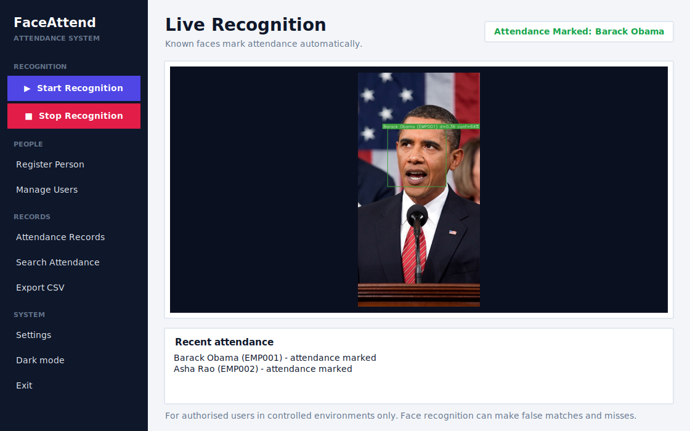
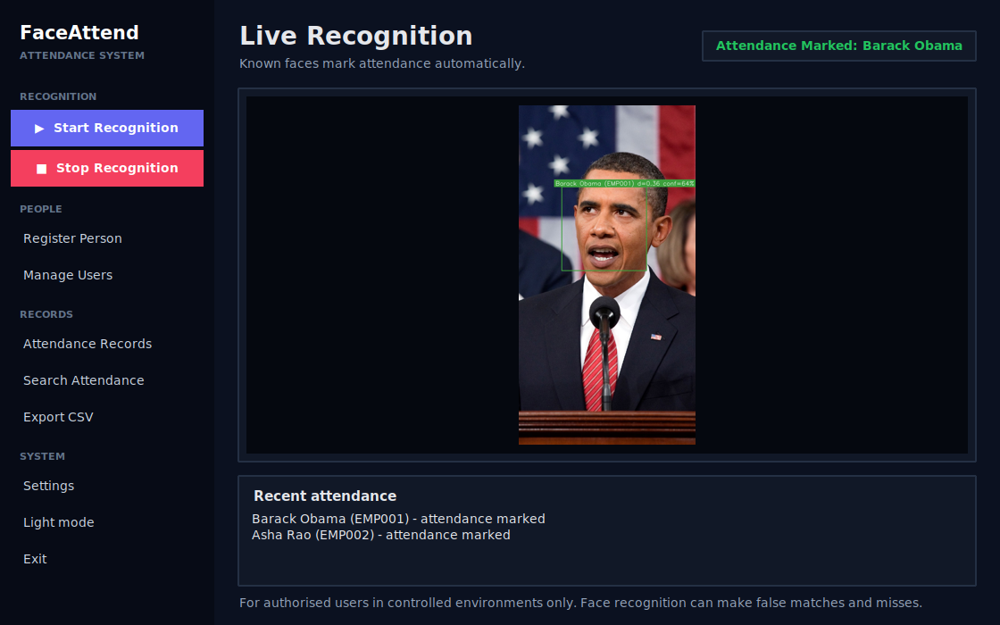
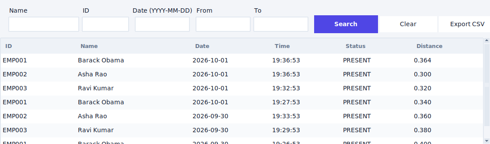
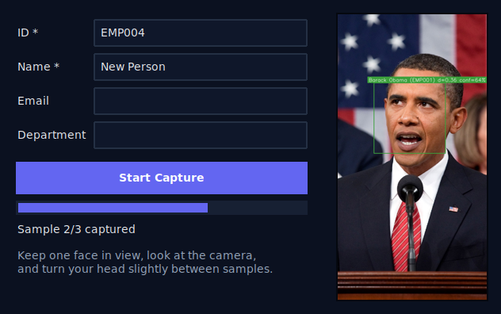

# Face Recognition Attendance System

A desktop application that registers people from a webcam, recognises them in real time using **pretrained face embeddings**, and records attendance in SQLite with duplicate prevention, search, and CSV export. Processing is 100% local.

> **Intended use:** authorised users in controlled environments (classroom, office). Face recognition can produce **false matches and false non-matches**; it is not perfectly accurate and should not be the only basis for important decisions.

## 1. Features
Register (name, ID, optional email/department) with quality-checked multi-sample capture · live recognition with name, ID, distance and a confidence heuristic · "Unknown" for non-matches · automatic attendance with configurable cooldown · attendance history with name / ID / date / date-range filters · CSV export · add/delete users and delete biometric data separately · settings dialog · rotating log file · friendly handling of camera, face, database and config errors.

## 2. AI/ML concepts used
| Concept | Where |
|---|---|
| Image acquisition, BGR→RGB, resizing, real-time loop | `core/camera.py`, `core/face_detector.py`, `utils/helpers.py` |
| **Face detection** (HOG + linear SVM, dlib) | `core/face_detector.py` |
| Face alignment (dlib landmarks inside the embedding step) | `core/face_encoder.py` |
| **Face embedding** (128-D vector from a pretrained ResNet-style CNN) | `core/face_encoder.py` |
| **Euclidean distance**, threshold, known/unknown decision, nearest-neighbour | `core/face_matcher.py` |
| Image-quality gating (face size, Laplacian-variance blur check) | `core/face_detector.py::assess_quality` |

**What the pretrained model does.** Input: an RGB image plus a face box. Output: 128 floats. The network was trained by its authors (dlib) on a large face dataset so that photos of the *same* person land close together and *different* people land far apart. This project **does not train a neural network**; it uses transfer of that pretrained knowledge (inference only) and adds its own matching, thresholding, storage and attendance logic.

**Why embeddings instead of raw pixels.** Pixel comparison breaks with lighting, pose, expression and camera distance. Embeddings compress a face into identity-focused numbers that are tiny (512 bytes), fast to compare, and can be stored without keeping photos.

**Matching.** For a query face, compute the Euclidean distance to every stored sample (one NumPy call), take the nearest. If `distance <= RECOGNITION_THRESHOLD` it is that person, otherwise "Unknown". Lower threshold → fewer false matches but more missed people (trade-off). Cosine similarity is provided for comparison; the matcher uses Euclidean because that is how the pretrained model is calibrated. The displayed *confidence* is a heuristic derived from distance (1.0 at d=0, 0.5 at d=threshold) — **not** a probability.

**Limitations.** Accuracy drops with poor light, extreme angles, masks/occlusion, low-res cameras, and varies across demographic groups. HOG detection is weaker at profile faces than modern CNN detectors. There is **no liveness detection**, so a printed photo or a screen can fool the system.

## 3. Technology stack
Python 3.11+ (tested on 3.12) · OpenCV · NumPy · Pandas (CSV) · Pillow (Tk image display) · dlib via `face_recognition` · Tkinter/ttk · SQLite · pytest · `logging`. No scikit-learn: nothing in this project needs it, and the instructions asked to avoid unnecessary libraries.

## 4. System architecture
```
Camera → resize + BGR→RGB → HOG face detector → boxes (scaled back)
      → 128-D embedding → Euclidean distance to cached embeddings → threshold
      → Known / Unknown → AttendanceManager (cooldown) → SQLite → GUI
```
Layers: `gui/` (Tk only) → `services/` (workflows) → `core/` (CV/ML + rules) → `database/`. Dependencies point downward only; no layer imports `gui`. `app_context.py` wires everything; `app.py` is the entry point.
Recognition runs on a **background thread** (`RecognitionRunner`); the GUI polls the latest annotated frame every ~33 ms, so the window never freezes.

**Performance choices:** detect on a 0.25× frame · recognise every Nth frame (default 3) and reuse the last boxes between · embeddings loaded once into a NumPy matrix (no per-frame DB query) · attendance cooldown cache in memory. Trade-off: faster but a face that appears for less than N frames may be missed, and boxes lag slightly behind fast movement. All timings depend on your CPU; **measure on your machine** (nothing is claimed here).

## 5. Project structure
```
app.py, app_context.py        entry point, dependency wiring
config/settings.py            validated settings (defaults < JSON < env vars)
database/ (db.py, models.py, schema.sql)
core/ (camera, face_detector, face_encoder, face_matcher, attendance)
services/ (registration_service, recognition_service, export_service)
gui/ (dashboard, registration, recognition, attendance_view, user_management, settings_dialog, widgets)
utils/ (errors, validators, helpers, logger)
tests/ (77 tests, no webcam needed)     docs/ (INTERVIEW_GUIDE.md, sample_empty.db)
```

## 6. Installation (Windows, PowerShell)

### Prerequisites

Before installing, ensure you have:

- Windows with PowerShell.
- Python 3.12 installed.
- pip package manager.
- Internet access.
- Project dependencies in requirements.txt.

Verify Python:

```powershell
py -3.12 --version
python -m pip --version
```

### Installation steps

```powershell
cd face_recognition_app
py -3.12 -m venv .venv
.\.venv\Scripts\Activate.ps1
python -m pip install --upgrade pip
pip install -r requirements.txt
pip install face-recognition==1.3.0 --no-deps
python -c "import face_recognition; print('face_recognition OK')"
```

If PowerShell blocks activation:

```powershell
Set-ExecutionPolicy -Scope Process Bypass
```

If you encounter a pkg_resources error:

```powershell
pip install "setuptools<81"
```

> Note: This installation route was verified on Linux/Python 3.12, not Windows. Windows compatibility may depend on available package wheels.


## 8. Registering a person
1. **Register Person** → enter ID and Name (email, department optional) → **Start Capture**.
2. Keep exactly one face in view; slightly turn your head between samples. Each frame is rejected with a message if there is no face, more than one face, the face is too small, or the image is blurry.
3. After the required number of good samples (default 10) the user and all embeddings are saved in one database transaction. If capture is interrupted, **nothing is saved**.

## 9. Recognition and attendance workflow
**Start Recognition** loads embeddings into memory and starts the camera. Known faces show `Name (ID) d=distance conf=%`; others show `Unknown`. A recognised person gets one `PRESENT` row; further sightings within the cooldown (default 300 s, also checked against the database after restarts) are ignored. **Attendance Records** filters by name, ID, date, or date range; **Export CSV** saves the displayed rows (UTF-8 with BOM for Excel).

## 10. Database design
```
users(id PK, employee_code UNIQUE, name, email, department, created_at)
face_embeddings(id PK, user_id FK→users ON DELETE CASCADE, embedding BLOB[128×float32], created_at)
attendance(id PK, user_id FK→users ON DELETE CASCADE, timestamp, status, recognition_distance)
```
Names are not duplicated in `attendance`; they come from a JOIN. Empty schema example: `docs/sample_empty.db`.

## 11. Testing
```powershell
pip install -r requirements-dev.txt
python -m pytest
```
77 tests cover: database (create/insert/duplicate/delete/cascade/filters/failures/corrupt file), validators, matching (same/different/threshold/unknown/empty), attendance cooldown, registration (success, empty name, duplicate ID, too few samples, no face, multiple faces, blur, small face, invalid images), camera unavailable/lost, recognition service, background runner, CSV export, settings. They use synthetic embeddings and fake cameras; **no webcam is required**.

## 12. What was and was not verified
Verified in development (Linux, Python 3.12): all automated tests; the real dlib pipeline on three still photos (register → recognise a *different* photo of the same person → a different person shown as Unknown → one attendance row); the full GUI under a virtual display with the camera absent (every error path). **Not verified:** live webcam capture, Windows, and any accuracy/FPS figures. After you run it, record your own numbers (FPS, false accept/reject rate on your users) here: `______`.

## 13. Screenshots
Light and dark themes (the dashboard uses a still photo instead of a live webcam feed):






## 14. Limitations
No liveness/anti-spoofing · accuracy varies with lighting, pose, occlusion and demographics · HOG detector is weak for side faces · embeddings are stored unencrypted in the local database · single-machine, single-camera · confidence is a heuristic.

## 15. Privacy considerations
Everything stays on the machine; no network calls. Only 128-number embeddings are stored — **no face images are saved or logged**, and logs contain IDs, not biometric data. Administrators can delete a person's face data alone (keeps attendance history) or delete the user completely. `data/*.db` is git-ignored. Embeddings can still be sensitive biometric data (they can be used to recognise a person): obtain consent, restrict access to the machine/DB file, and follow your local law (e.g. India's DPDP Act, GDPR). Enable disk encryption (BitLocker) for real deployments.

## 16. Future enhancements
Liveness detection · SQLCipher encryption · CNN/YuNet detector for better angles · multiple cameras · role-based admin login · web dashboard · threshold calibration tool using labelled data · attendance reports/charts.

## 17. Author

**Mayuri Kurhe**  
MCA Graduate | Software Developer

- GitHub: [@mayurik12](https://github.com/mayurik12)
- Portfolio: [mayuri-portfolio-two.vercel.app](https://mayuri-portfolio-two.vercel.app)
- Email: mayurikurhe8@gmail.com

  ## 18. Contributing

Contributions are welcome!

1. Fork this repository.
2. Create a feature branch.
3. Make your changes.
4. Test your changes before submitting.
5. Open a pull request with a clear description.

Please ensure that changes preserve user privacy and do not expose biometric data.

## 19. License

Please refer to the repository's LICENSE file for licensing information.
